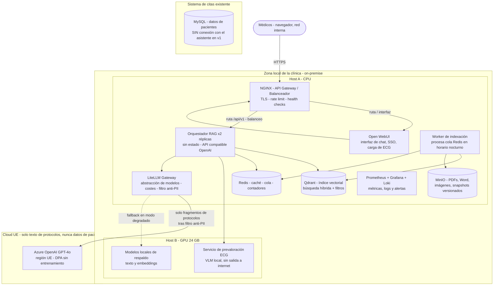
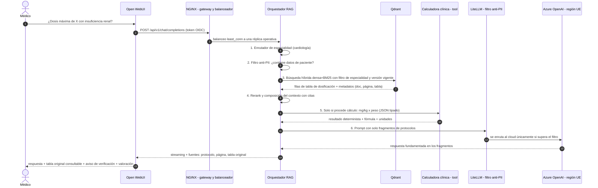
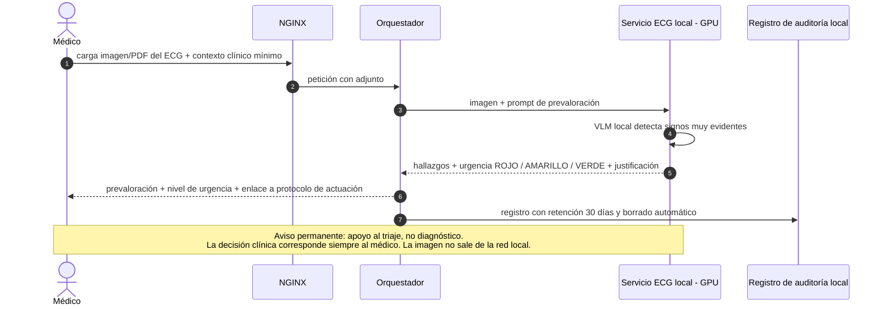
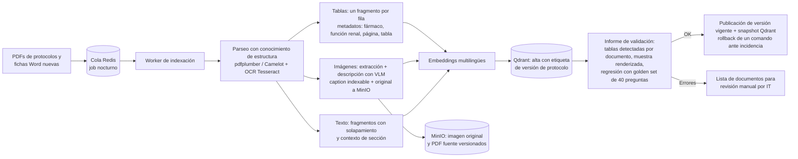
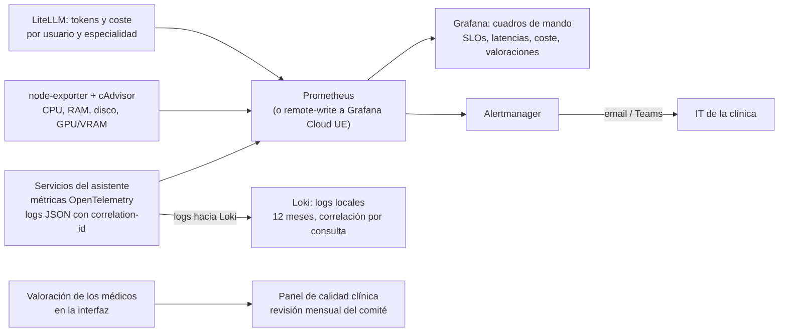
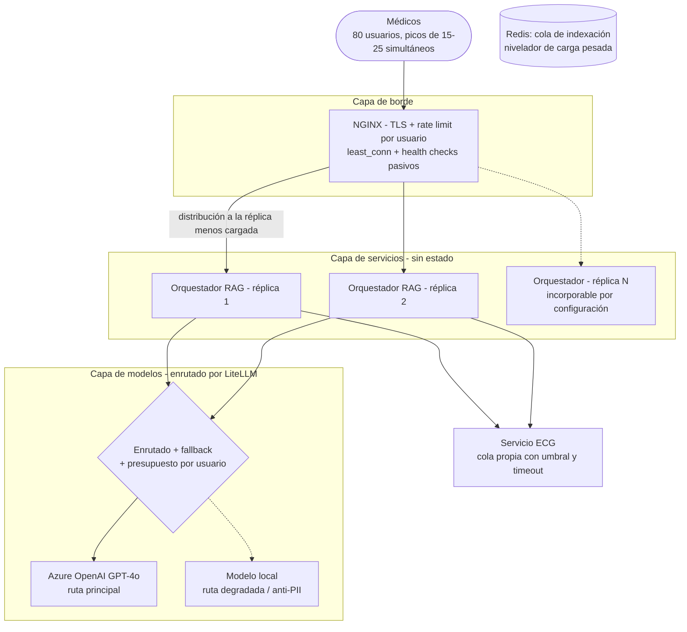

# Propuesta de solución — Asistente Clínico Interno con IA

**Cliente:** clínica privada de tamaño medio (≈80 profesionales sanitarios; equipo de IT de una persona).
**Alcance del documento:** propuesta de solución a nivel de diseño, sin implementación de código. Secciones 1 a 5: entregable solicitado. Secciones 6 a 9: profundización en diagramas, escalabilidad, monitorización y control de abstracción (microservicios y balanceadores).

---

## Índice

1. [Resumen ejecutivo](#1-resumen-ejecutivo)
2. [Arquitectura propuesta](#2-arquitectura-propuesta)
3. [Decisiones tecnológicas clave](#3-decisiones-tecnológicas-clave)
4. [Lo que el sistema NO hará (y por qué es importante decirlo)](#4-lo-que-el-sistema-no-hará-y-por-qué-es-importante-decirlo)
5. [Riesgos del proyecto](#5-riesgos-del-proyecto)
6. [Escalabilidad](#6-escalabilidad)
7. [Monitorización y observabilidad](#7-monitorización-y-observabilidad)
8. [Control de abstracción: microservicios y balanceadores](#8-control-de-abstracción-microservicios-y-balanceadores)
9. [Operación y mantenibilidad con un equipo de IT de una persona](#9-operación-y-mantenibilidad-con-un-equipo-de-it-de-una-persona)
10. [Matriz de trazabilidad de requisitos](#10-matriz-de-trazabilidad-de-requisitos)

---

## 1. Resumen ejecutivo

Se propone un **asistente de consulta de protocolos clínicos** al que los profesionales sanitarios formulan preguntas en lenguaje natural (interfaz web, en español) y que responde **citando de forma obligatoria el protocolo, la página y la tabla exacta** de los que procede la información. El sistema incorpora además dos capacidades complementarias: **cálculos deterministas** (p. ej., dosis en función del peso, con fórmula visible y verificable) y **prevaloración de electrocardiogramas** con nivel de urgencia, manteniendo la decisión clínica en todo momento bajo criterio médico.

Adecuación del diseño a las circunstancias del cliente:

- **Protección de datos por diseño.** Los datos de pacientes (MySQL del sistema de citas) **no se conectan al asistente** en esta fase y ningún dato de paciente abandona la red de la clínica. Los ECG se procesan con un modelo **local**, en servidor propio. Únicamente salen de la red fragmentos de texto de los protocolos (documentación interna, no datos personales) hacia el modelo de lenguaje alojado en cloud de la UE, amparado por acuerdo de tratamiento de datos sin entrenamiento.
- **Especialización por especialidad sin multiplicar modelos.** La petición de un modelo por especialidad se materializa como **enrutado por especialidad**: un único modelo base combinado con colecciones de índice, instrucciones y filtros propios de cada servicio clínico. Resulta más económico, auditable y mantenible.
- **Mantenibilidad con un único perfil técnico.** El despliegue completo se realiza mediante contenedores Docker con un único fichero de configuración. Las tareas recurrentes (actualización de protocolos cada 3–6 meses, copias de seguridad, revisiones) responden a procedimientos documentados y automatizados. El personal de IT opera el sistema; no lo desarrolla.
- **Coste contenido.** Inversión única en hardware: dos servidores propios (uno con GPU). Presupuesto operativo de cloud estimado en **100–250 €/mes**, con topes de gasto configurables por usuario y por organización.
- **Degradación controlada.** Ante una incidencia del proveedor de cloud o el agotamiento del presupuesto, el sistema continúa operando en *modo degradado* con el modelo local, sin dejar al usuario sin respuesta ni sin notificación del estado del servicio.

Síntesis del alcance funcional: **una herramienta de apoyo a la consulta basada en los protocolos propios de la clínica, con fuentes trazables, cálculo fiable y prevaloración de ECG, sin exponer dato alguno de paciente fuera de la organización.**

---

## 2. Arquitectura propuesta

### 2.1 Principios de diseño

1. **Separación de datos por sensibilidad** — datos de pacientes (on-premise, inaccesibles al asistente en v1) ≠ documentación clínica (on-premise, indexable) ≠ inferencia LLM (cloud UE, únicamente sobre fragmentos de protocolos).
2. **Dimensionamiento ajustado al requisito** — microservicios de grano grueso con contratos explícitos, desplegados en dos hosts mediante docker-compose. Se descarta Kubernetes en esta fase: su operación absorbería por completo la capacidad del equipo de IT.
3. **Estado externalizado** — los servicios que atienden a los usuarios son *sin estado*; en consecuencia, se balancean y escalan mediante adición de réplicas.
4. **Trazabilidad completa** — toda respuesta se registra con sus fuentes (usuario, fecha, documentos y páginas) para auditoría clínica y cumplimiento RGPD.
5. **Degradación controlada** — cada dependencia externa (cloud, GPU) dispone de mecanismo de respaldo y política de saturación definida.

### 2.2 Localización de los datos (y salidas a internet)

| Dato | Localización | ¿Sale a internet? | Acceso |
|---|---|---|---|
| Datos de pacientes (MySQL del sistema de citas) | Red de la clínica, **sin conexión alguna con el asistente en v1** | **Nunca** | Exclusivamente el sistema de citas |
| ECG remitidos por los médicos | Nodo GPU local; retención 30 días con borrado automático | **Nunca** (salida bloqueada por firewall) | Servicio ECG local |
| PDF/Word originales de protocolos y fichas | MinIO on-premise (versionado) | No | Worker de indexación; médicos mediante la interfaz (lectura citada) |
| Índice vectorial (fragmentos) | Qdrant on-premise | No | Orquestador |
| Fragmentos de texto de protocolos hacia el LLM | En tránsito cifrado, región UE, DPA sin entrenamiento | **Sí, únicamente fragmentos de protocolos tras el filtro anti-PII** | LiteLLM → Azure OpenAI |
| Historial de preguntas/respuestas (auditoría) | Registros on-premise, 12 meses | No | IT y comité de calidad (solo lectura) |

### 2.3 Diagrama general de componentes

Aspectos relevantes: los usuarios acceden a través de una única pasarela; el sistema de citas permanece **fuera** del perímetro del asistente; el único contenedor con salida a internet es LiteLLM, exclusivamente hacia el endpoint de Azure (lista de permitidos en firewall).

### 2.4 Microservicios (grano grueso, contratos explícitos)

| Servicio | Réplicas v1 | ¿Estado? | Responsabilidad | Contrato |
|---|---|---|---|---|
| NGINX gateway/balanceador | 1 | No | Punto único de entrada, TLS, rate limit por usuario, balanceo y health checks | HTTP rutas `/` y `/api/v1/*` |
| Open WebUI (frontend) | 1 | No | Chat en español, SSO OIDC contra el Active Directory de la clínica, carga de imágenes ECG, valoración de respuestas | — |
| Orquestador RAG (FastAPI) | **2** | No | Enrutador de especialidad, recuperación híbrida, rerank, herramienta de cálculo, composición de citas, streaming. Expone API **compatible OpenAI**, lo que permite su consumo por el frontend sin adaptaciones | OpenAPI `/api/v1` |
| Servicio ECG (GPU local) | 1 | No | Prevaloración con VLM local: hallazgos evidentes, nivel de urgencia y aviso legal obligatorio | OpenAPI interno |
| Worker de indexación | 1 | No | Parseo PDF/Word, extracción de tablas e imágenes, embeddings, alta versionada en Qdrant + MinIO | Mensajes de cola Redis |
| LiteLLM gateway | 1 | No | Abstracción de modelos (cloud/local), presupuestos y costes por usuario, fallback, filtro anti-PII | OpenAI-compatible |
| Qdrant / MinIO / Redis | 1 cada uno | **Sí** | Índice vectorial / repositorio documental versionado / caché, cola y contadores | Internos, sin puertos publicados |

Justificación del dimensionamiento: seis servicios con estado nulo o externalizado resultan suficientes para 80 usuarios. Los límites están definidos de modo que el crecimiento se resuelva añadiendo réplicas o hosts, nunca rediseñando la solución.

### 2.5 Flujo de una consulta (de la pregunta del médico a la respuesta)

Descripción de las etapas críticas:

- **(2) Filtro anti-PII:** clasificador ligero y reglas deterministas. Ante la detección de datos de paciente en la consulta, la petición se deriva al modelo **local** y se informa al médico; ningún contenido viaja al cloud.
- **(3) Recuperación:** búsqueda híbrida (semántica y léxica), dado que las consultas de dosificación contienen nombres de fármaco que BM25 resuelve con mayor precisión que el vector denso.
- **(5) Cálculo:** el modelo de lenguaje **no ejecuta operaciones aritméticas**; se limita a emitir parámetros tipados, y la calculadora (módulo versionado con pruebas unitarias) devuelve resultado, fórmula y unidades empleadas.
- **Citas:** toda afirmación cuantitativa debe anclarse a un fragmento recuperado; si no existe fragmento que la sustente, el sistema declara "no encontrado en los protocolos" y remite al canal oficial (antialucinación por diseño; véase la sección 4).

### 2.6 Flujo de prevaloración de ECG

Niveles de urgencia (regla de negocio configurable por el comité de protocolos):

- **ROJO** — signos de riesgo vital calificados como evidentes en el protocolo: mensaje destacado con vía de actuación inmediata.
- **AMARILLO** — hallazgos relevantes sin criterio de alarma: sugerencia de revisión por cardiólogo.
- **VERDE** — sin hallazgos evidentes para el modelo: se informa de las limitaciones de la prevaloración.

### 2.7 Pipeline de indexación (actualizaciones de protocolos, cada 3–6 meses)

### 2.8 Especialización por especialidad médica: implementación

La petición de un modelo por especialidad se materializa como **enrutado por especialidad sobre un modelo base compartido**:

1. **Colecciones o espacios de nombres por especialidad en Qdrant**, con filtros por payload (especialidad, tipo de documento, versión vigente).
2. **Instrucciones de sistema por especialidad** (convenciones de dosificación, umbrales locales, circuitos de escalado).
3. **Selector en la interfaz**, con clasificación automática ligera de la consulta como alternativa.
4. **Evolución posterior opcional:** adaptadores LoRA por especialidad sobre el mismo modelo base, únicamente si el comité de calidad acredita la necesidad con datos de uso reales.

Justificación de negocio: entrenar y mantener entre 10 y 15 modelos ajustados por fine-tuning multiplicaría el coste de GPU y la carga de mantenimiento (inviable para un equipo de IT de una persona) sin mejorar la precisión respecto a la especialización por recuperación, que además es íntegramente auditable.

### 2.9 Seguridad y RGPD (síntesis)

- **SSO OIDC** contra el Active Directory existente; acceso restringido al personal sanitario autorizado; roles básicos (médico / IT / auditor).
- **TLS en la totalidad del trayecto** (incluida la red interna) y secretos externalizados de las imágenes (fichero `.env` con permisos restringidos).
- **Segmentación de red:** los servicios internos no publican puertos; la única salida a internet es LiteLLM → endpoint Azure (lista de permitidos en firewall).
- **Minimización:** v1 no accede a MySQL; los ECG se eliminan a los 30 días; los registros de auditoría se conservan 12 meses en local.
- **Contratos:** DPA con el proveedor de cloud (región UE, sin entrenamiento con los datos), pendiente de validación por el asesor legal del cliente; se recomienda completar una **EIPD/DPIA** antes del despliegue, al tratarse de datos de salud.

---

## 3. Decisiones tecnológicas clave

| Componente | Decisión propuesta | Justificación para este cliente |
|---|---|---|
| **Modelo LLM (¿cloud o local?)** | **Híbrido.** Cloud GPT-4o vía Azure OpenAI (región UE, DPA sin entrenamiento) para el RAG de protocolos; **modelo local** (Qwen2.5-VL 7B / Llama 3.1 8B vía Ollama en GPU propia) para ECG y cualquier flujo con datos de paciente, seleccionado mediante filtro anti-PII. | La capacidad de razonamiento clínico en español de un modelo local de tamaño reducido es inferior y exigiría GPUs de mayor coste y mantenimiento; el cloud aporta calidad con coste por uso, coherente con un presupuesto moderado. Los datos de paciente no salen de la organización (RGPD): el ECG y todo lo que el filtro marque se procesan en local. Para un equipo de IT sin experiencia en Python, no se requieren instalaciones de frameworks ML: todo se articula en contenedores. |
| **Base de datos vectorial** | **Qdrant self-hosted** (1 contenedor Docker). | El corpus es de tamaño reducido (~80 documentos ≈ 5.000–10.000 fragmentos), muy por debajo de cualquier límite. Qdrant aporta búsqueda híbrida (densa + dispersa) con filtros por especialidad/versión —decisivo para tablas de dosificación y multiversión de protocolos—, consola web de administración y snapshots de copia de seguridad ejecutables con un comando. Se descarta pgvector para no incorporar una segunda tecnología de base de datos al parque de mantenimiento. |
| **Indexación de las tablas de dosificación** | **Extracción estructurada en ingestión + fragmento por fila**, con metadatos (fármaco, función renal, página, tabla) y la tabla padre en Markdown enlazada para su cita. | Las consultas de dosis son búsquedas por fila ("fármaco X + insuficiencia renal"), no por página: el fragmento-fila hace la recuperación exacta y la cita muestra al médico la **tabla original** del PDF, no una paráfrasis del modelo. Se garantiza así que la respuesta se apoye en el contenido literal del protocolo (documento, página y tabla). |
| **Tratamiento de las imágenes clínicas de los PDFs** | **Extracción en ingestión + descripción automática con VLM** (caption) indexada como texto; la imagen original se conserva en MinIO y se sirve como fuente citable en la respuesta. | Permite la búsqueda por descripción ("patrón delta en ECG de referencia") sin indexar píxeles, y el médico visualiza siempre la imagen original citada con su protocolo y página. Evita además reenviar imágenes en cada consulta: el procesamiento intensivo se realiza una única vez por versión del protocolo. |
| **Herramienta de cálculos del médico** | **Tool calling con función determinista**: el LLM emite parámetros tipados (JSON) y una calculadora clínica versionada, con pruebas unitarias, devuelve resultado, fórmula y unidades. | Aritmética reproducible y auditable; elimina la clase de error más crítica (alucinación numérica). El médico visualiza la fórmula y las entradas empleadas, condición necesaria para la confianza clínica y para la auditoría posterior del cálculo. |
| **Interfaz de usuario** | **Open WebUI** (contenedor Docker) tras la pasarela, con SSO OIDC, en español, carga de imágenes y valoración integrada; el orquestador se registra como un "modelo" compatible OpenAI. | Suprime el desarrollo y mantenimiento de un frontend propio y se actualiza con un comando. Al exponer el orquestador una API compatible OpenAI, la interfaz se integra sin personalizaciones frágiles. Acceso mediante navegador desde puesto de trabajo, móvil o tablet, sin instalación en los 80 equipos. |

**Componentes adicionales** derivados de los requisitos de escalabilidad, monitorización y abstracción:

| Componente | Decisión propuesta | Justificación para este cliente |
|---|---|---|
| Puerta de enlace y balanceador | **NGINX** (TLS, rate limit por usuario, least_conn, health checks) | Estándar consolidado, configuración declarativa accesible para el personal de IT y punto único de entrada que oculta la topología interna (sección 8). |
| Abstracción de modelos | **LiteLLM gateway** entre orquestador y modelos | La sustitución de GPT-4o por Claude o por un modelo local es una operación de configuración, no de código; aporta presupuesto por usuario, telemetría de coste y fallback automático. |
| Monitorización | **Prometheus + Grafana + Loki** self-hosted (o Grafana Cloud UE, nivel gratuito) | Métricas, registros y alertas en un stack de contenedores sin agentes adicionales que mantener (sección 7). |
| Almacenamiento documental | **MinIO** (buckets versionados) + snapshots Qdrant | Versionado nativo por actualización de protocolo y restauración de un comando: imprescindible con cambios cada 3–6 meses y un único perfil de IT. |
| Autenticación | **OIDC contra el Active Directory existente** | Reutiliza las identidades y la política de rotación de contraseñas vigentes; evita mantener un nuevo gestor de identidades. |

---

## 4. Lo que el sistema NO hará (y por qué es importante decirlo)

1. **No diagnostica ni interpreta ECG de forma definitiva, y no prescribe.** Únicamente prevalora *signos muy evidentes* con nivel de urgencia y aviso permanente de que la decisión corresponde al médico. Razón técnica y de negocio: exceder ese ámbito convertiría el software en **dispositivo médico** (Reglamento UE 2017/745 – MDR), con un ciclo de certificación, coste y responsabilidad que la clínica no está dispuesta a asumir; adicionalmente, la fiabilidad de los VLM actuales no resulta suficiente para interpretación definitiva.
2. **No consulta la historia clínica ni los datos de pacientes del MySQL.** El peso, la edad o la función renal los introduce el médico en su consulta. Razón: minimización de datos (RGPD), ausencia de casos de uso de v1 que lo exijan y prevención de la exposición de datos sanitarios por error del asistente. De aprobarse en el futuro, se implementaría en una fase 2 mediante conector de solo lectura, seudonimizado y confinado al modelo local.
3. **No mantendrá un modelo entrenado por especialidad (fine-tuning).** Razón: no existe volumen de datos que lo justifique; el coste de GPU y de reentrenamiento ante cada cambio de protocolo es desproporcionado y resultaría inmantenible para un equipo de IT de una persona. El resultado funcional equivalente se obtiene con enrutado por especialidad (sección 2.8), auditable y actualizable en minutos.
4. **No genera respuestas sin fuente verificable:** si la información no consta en los protocolos indexados, el sistema lo declara. Razón: es la única política compatible con la seguridad clínica y con la exigencia de cita obligatoria; resulta preferible una respuesta "sin constancia documentada, consulte al comité de protocolos" antes que una respuesta verosímil e inverificable.

La delimitación explícita del alcance gestiona las expectativas del personal sanitario y acota la responsabilidad clínica y legal del sistema.

---

## 5. Riesgos del proyecto

| # | Riesgo (específico del proyecto) | Impacto | Probabilidad | Mitigación propuesta |
|---|---|---|---|---|
| 1 | **Dosificación alucinada o mal citada**: el modelo parafrasea incorrectamente una fila de tabla ante una consulta crítica | Alto (seguridad clínica) | Media | Grounding estricto: respuesta únicamente a partir de fragmentos recuperados; cita obligatoria (documento, página, tabla) mostrando la **tabla original**; calculadora determinista para la aritmética; aviso permanente de verificación; revisión mensual por el comité de las respuestas con valoración negativa. |
| 2 | **Extracción deficiente de tablas en PDFs heterogéneos** (~80 documentos con maquetaciones distintas y documentos escaneados) | Alto (respuestas incompletas) | Alta | Informe de validación por documento en cada ingesta (tablas detectadas + muestra renderizada); lista de documentos pendientes de corrección manual; **golden set de 40 preguntas de regresión** que toda versión del índice debe superar antes de publicarse; rollback de un comando. |
| 3 | **Dependencia del proveedor de cloud**: interrupción de conectividad, variación de precios o de las condiciones de tratamiento de datos | Medio | Media | LiteLLM como capa de abstracción (sustitución de modelo por configuración); **modo degradado** con modelo local ante indisponibilidad o agotamiento del tope de gasto; presupuestos mensuales configurados; revisión anual del DPA. |
| 4 | **Saturación del nodo GPU local (ECG)** en horas punta (pasos de visita) | Medio | Media | Cola con límite y timeout explícito (mensaje de servicio ocupado, sin bloquear al médico); alerta por profundidad de cola; medición del throughput real en el PoC con conjunto etiquetado por cardiólogos; plan de ampliación (segunda GPU o batching) si los percentiles lo requieren. |
| 5 | **Carga operativa excesiva para un equipo de IT de una persona sin experiencia en Python** | Alto (viabilidad) | Media | Totalidad de la solución en docker-compose + `.env`; runbooks de incidencias frecuentes; copias de seguridad y reindexación automatizadas; soporte del proveedor con SLA durante el primer año; matriz de responsabilidades clínica/IT/proveedor (sección 9). |

---

## 6. Escalabilidad

### 6.1 Modelo de demanda

| Parámetro | Estimación |
|---|---|
| Usuarios totales | 80 profesionales |
| Concurrencia real en punta (pasos de visita, 8–11 h) | 15–25 sesiones simultáneas |
| Peticiones/s sostenidas en punta | 2–4 req/s (respuestas en streaming de 5–15 s) |
| Preguntas/día | 800–1.500 |
| Ingesta | 80 documentos cada 3–6 meses, job nocturno — incidencia despreciable sobre la carga |
| Corpus indexado | ~5.000–10.000 fragmentos (tamaño reducido para Qdrant) |

Conclusión del dimensionamiento: la carga es **moderada** y el cuello de botella efectivo es la latencia del LLM (1–4 s), no el rendimiento interno. El diseño garantiza que todo componente distinto del LLM responda en <200 ms y que el crecimiento no exija rediseños.

### 6.2 Estrategia por capa

| Capa | Límite efectivo | Estrategia de escala |
|---|---|---|
| NGINX gateway | Miles de req/s (muy superior a lo requerido) | Rate limit por usuario como protección del conjunto; no precisa escalado en el horizonte del proyecto |
| Orquestador RAG | ~centenares de req/s por réplica | **Sin estado** → 2 réplicas en v1; la incorporación de una réplica es una línea de configuración |
| Qdrant | Millones de vectores | Un nodo resulta suficiente; snapshots y réplica de lectura únicamente si el corpus crece 10× |
| Cloud LLM | Límites TPM de la cuenta | Cuota aprovisionada; LiteLLM encola y distribuye; caché semántica/exacta por (pregunta, versión de protocolo) — los protocolos permanecen estables 3–6 meses, la tasa de repetición de consultas es elevada y el ahorro resultante es significativo |
| GPU local (ECG) | Throughput del VLM (a medir en el PoC) | Cola con umbral y degradación explícita; batching; segunda GPU como alternativa de ampliación |
| Redis / MinIO | Ampliamente superior a lo necesario | Sin acción; dimensionados con margen |

### 6.3 Plan de crecimiento escalonado

| Fase | Disparador | Acción |
|---|---|---|
| **v1 (80 usuarios)** | — | 2 hosts (A: CPU + servicios; B: GPU). docker-compose. Orquestador ×2. |
| **v2 (más clínicas del grupo / uso intensivo)** | p95 > SLO o >150 usuarios | Réplicas adicionales del orquestador en un nuevo host; réplica de lectura de Qdrant; NGINX continúa balanceando sin cambios |
| **v3 (multi-sede)** | Varias sedes con requisitos de latencia | Nodo GPU por sede; interconexión WAN entre pasarelas; los contratos HTTP ya lo admiten |

Consideración de diseño: la adopción de Kubernetes en las fases v1/v2 constituiría sobreingeniería que un equipo de una persona no puede sostener (equivale a un puesto de trabajo completo). El despliegue compose con contratos versionados y servicios sin estado ya proporciona escalabilidad horizontal cuando resulte necesaria.

---

## 7. Monitorización y observabilidad

### 7.1 Stack y flujo

Política de privacidad del stack: las métricas y trazas **no contienen texto de consultas ni datos de paciente** (únicamente contadores, latencias e identificadores de correlación hashed); los registros con texto residen en Loki on-premise. De optarse por Grafana Cloud, únicamente saldría de la red telemetría numérica hacia la región UE.

### 7.2 SLO y métricas clave

| Métrica | Objetivo (SLO) |
|---|---|
| Disponibilidad en horario clínico | ≥ 99,5 % |
| Latencia hasta la primera palabra (streaming), p95 | < 3 s |
| Latencia total de respuesta, p95 | < 10 s |
| Tasa de respuestas sin fuente recuperada | < 10 % (y declaradas como "no encontrado") |
| Tasa de valoración negativa de respuestas | < 5 % (sujeta a revisión del comité) |
| Profundidad de cola ECG | < 5 en p95 |
| Errores 5xx del gateway | < 1 % |
| Coste cloud mensual | ≤ tope configurado (alerta al 80 %) |

### 7.3 Alertas (severidad y canal)

| Severidad | Condición | Canal |
|---|---|---|
| Crítica | Gateway no operativo, Qdrant no operativo, GPU OOM, fallo del backup nocturno | Email + Teams, notificación inmediata |
| Alta | p95 > SLO durante 15 min, cola ECG > 5, errores cloud > 5 %, coste al 80 % del tope | Teams, en horario clínico |
| Informativa | Disco > 80 %, certificado TLS < 30 días, versión de protocolo pendiente de validar | Email diario |

### 7.4 Auditoría y ciclo de calidad clínica

- **Registro auditable:** cada respuesta queda registrada en local con autor, fecha, fragmentos citados (documento/página/tabla) y valoración recibida, con retención de 12 meses. Satisface el principio de responsabilidad del RGPD y las auditorías clínicas.
- **Ciclo de mejora:** panel mensual para el comité con las respuestas de valoración negativa y las consultas "no encontrado", que alimenta los ajustes de fragmentado e instrucciones y la siguiente actualización de protocolos. La calidad del sistema se gobierna con datos de uso real.

---

## 8. Control de abstracción: microservicios y balanceadores

Esta sección atiende el requisito de **consumo simultáneo por múltiples usuarios**, con control explícito de las capas de abstracción y del balanceo.

### 8.1 Punto único de entrada (patrón gateway)

- Los usuarios acceden exclusivamente a una dirección interna (`asistente.clinica.local`) servida por NGINX; ningún servicio interno expone puertos y todos operan en redes Docker privadas.
- **Contratos versionados** (`/api/v1`, OpenAPI por servicio): posibilitan la evolución de un microservicio sin romper a los consumidores, con política de obsolescencia documentada.
- El orquestador expone **API compatible OpenAI**: cualquier cliente capaz de dialogar con un LLM puede consumir el asistente sin adaptaciones, por lo que la incorporación de consumidores futuros no requiere desarrollo adicional.

### 8.2 Matriz de abstracción (elementos sustituibles sin afectar al resto)

| Capa | Mecanismo de abstracción | Permite cambiar… |
|---|---|---|
| Cliente ↔ sistema | Gateway NGINX + contratos OpenAPI `/api/v1` | El frontend completo, o añadir un segundo consumidor, sin modificar servicios |
| Servicios ↔ modelos | LiteLLM (API OpenAI-compatible) | GPT-4o → Claude → modelo local: operación de configuración |
| Lógica ↔ datos | El orquestador únicamente accede a Qdrant/MinIO/Redis mediante interfaces internas | MinIO por otro S3, o Qdrant por otro vectorial, sin afectar a la lógica clínica |
| Lógica ↔ GPU | Servicio ECG como contrato OpenAPI interno | El VLM local sin modificar el orquestador |
| Cálculo ↔ modelo | Tool calling con esquema tipado | La calculadora (con versión propia) sin alterar las instrucciones base |

### 8.3 Topología de balanceo y multiusuario

Políticas de balanceo por capa:

| Capa | Política | Justificación |
|---|---|---|
| NGINX → orquestador | `least_conn` + health checks pasivos (`max_fails`); sin afinidad de sesión (servicios sin estado) | Las peticiones se extienden varios segundos (streaming): la distribución por menor carga evita que una respuesta prolongada sature una réplica |
| NGINX, borde | Rate limit por usuario (req/min) + tamaño máximo de subida | Protege la GPU y el presupuesto cloud ante consumo anómalo de un usuario o proceso; el uso concurrente no puede degradar el servicio del resto |
| LiteLLM → modelos | Enrutado por tipo de petición (anti-PII → local), fallback cloud→local, presupuestos por usuario y organización | Aísla fallos del proveedor, contiene el coste y aplica el RGPD en el propio plano de datos |
| Cola Redis (ingesta) | Job nocturno, reintentos con backoff | La carga intensiva (indexar 80 PDF) nunca compite con la atención a médicos (bulkhead asíncrono) |
| Cola ECG | Umbral + timeout + respuesta de saturación explícita | El médico no permanece bloqueado en espera; la GPU queda protegida en punta |

### 8.4 Resiliencia (comportamiento ante fallos)

- **Timeouts** en todas las llamadas externas (cloud, GPU) y reintentos acotados con backoff.
- **Circuit breaker cloud:** superado el umbral de fallos, LiteLLM conmuta al modelo local y la interfaz informa del "modo degradado: respuestas de menor detalle hasta restaurar el servicio".
- **Bulkheads:** la ingesta se ejecuta en un worker independiente; el ECG dispone de cola propia; un fallo en un plano no se propaga a los demás.
- **Despliegues blue/green:** se levanta la nueva réplica, el health check valida y NGINX conmuta, sin ventana de interrupción para los usuarios.

---

## 9. Operación y mantenibilidad con un equipo de IT de una persona

**Alcance de las tareas del personal de IT:**

| Tarea | Frecuencia | Procedimiento |
|---|---|---|
| Incorporar nuevas versiones de protocolos al repositorio de ingesta | Cada 3–6 meses | Copia de ficheros; el job nocturno indexa, valida y publica con snapshot |
| Revisar el informe de validación de ingesta | Tras cada actualización | Documento/cuadro de mando con tablas detectadas y errores por documento; corrección manual únicamente de los señalados |
| Copias de seguridad | Automática, diaria | Snapshots Qdrant + MinIO versionado + configuración en Git; restauración mediante runbook de una página |
| Actualizar contenedores | Trimestral, con ventana acordada | `docker compose pull && docker compose up -d` (procedimiento documentado) |
| Supervisión de cuadros de mando y alertas | Diaria (5 minutos) | Grafana; las alertas críticas se notifican de forma proactiva por email/Teams |
| Desarrollo de software o modificación de modelos | **No requerida** | Contratos versionados y configuración declarativa; la evolución corresponde al proveedor o a fases contratadas |

**Matriz de responsabilidades, año 1:** clínica (protocolos, criterios clínicos, gobernanza) · IT (operación de contenedores, ingesta, copias de seguridad) · proveedor (desarrollo inicial, PoC ECG, soporte con SLA, formación del personal de IT en dos sesiones).

---

## 10. Matriz de trazabilidad de requisitos

| Requisito del cliente / del entregable | Sección |
|---|---|
| Resumen ejecutivo apto para el director médico | 1 |
| Diagrama de componentes con relaciones | 2.3 |
| Localización de datos de pacientes frente a documentos clínicos | 2.2, 2.3, 2.9 |
| Componentes cloud frente a componentes locales | 2.3 (y por componente en 3) |
| Flujo de la pregunta del médico hasta la respuesta | 2.5 |
| Flujo de prevaloración de ECG con nivel de urgencia | 2.6 |
| Modelo especializado por especialidad médica (criterio de implementación) | 2.8 |
| Tabla de decisiones tecnológicas cumplimentada | 3 |
| Delimitación de lo que el sistema no hará, con justificación | 4 |
| Riesgos reales con mitigación | 5 |
| **Énfasis: diagramas** | 2.3, 2.5, 2.6, 2.7, 7.1, 8.3 |
| **Énfasis: escalabilidad multiusuario** | 6 |
| **Énfasis: monitorización** | 7 |
| **Énfasis: control de abstracción, microservicios y balanceadores** | 2.4, 8 |
| Restricción: mantenibilidad con un equipo de IT de una persona, sin Python | 9 (y riesgo 5) |
